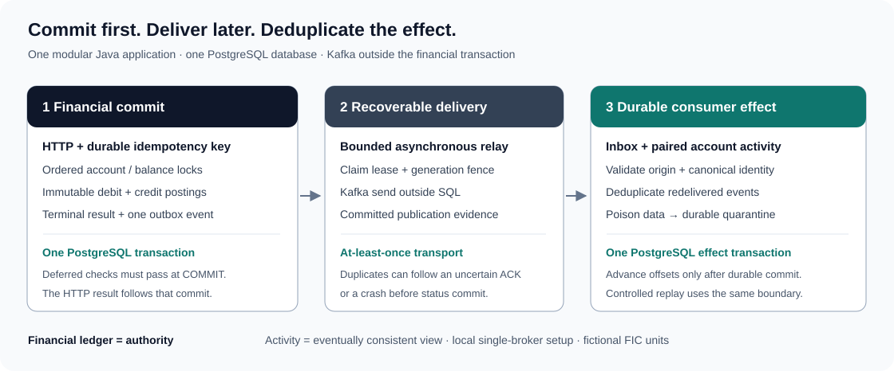
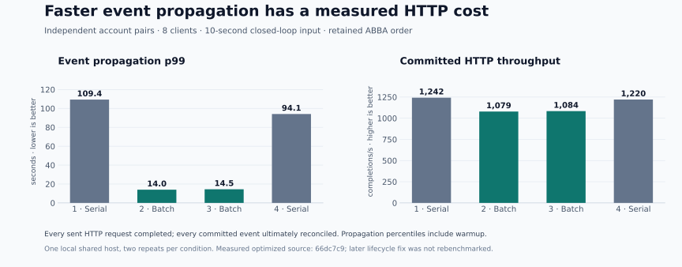

# Transaction Processing Platform

**A transaction ledger that keeps its financial boundary intact when event delivery fails.**

Java 21 · Spring Boot · PostgreSQL · Apache Kafka · Docker

An independent backend engineering project: exact integer transfers, an immutable double-entry ledger, a transactional outbox and a durable consumer inbox. The system demonstrates **at-least-once delivery with idempotent PostgreSQL effects**. It uses fictional units, one modular application and real dependency tests.

[Run the demo](#run-the-demo) · [Read the engineering story](docs/portfolio-walkthrough.md) · [Inspect the evidence](docs/evidence.md) · [Browse the code](docs/code-map.md)

## Run the demo

On macOS or Linux, start local Docker with Compose and use Python 3.10 or newer. The first run builds the app and starts PostgreSQL and Kafka. You do not need a host JDK.

```sh
git clone --branch v0.2.3 --depth 1 https://github.com/Alaneel/transaction-processing-platform.git
cd transaction-processing-platform
python3 scripts/demo.py
```

Open the **Browser demo** URL printed by the launcher. The default is [Transfer Lab](http://127.0.0.1:38080/demo/index.html). After startup, the full flow uses buttons.

1. Leave the default 7 FIC amount, enable **Lose the reply on purpose**, and choose **Save receipt & send**.
2. When the result is unknown, choose **Download private receipt**. In a fresh browser session, open the **same URL** against the **same retained database**, import the file, then choose **Recover this transfer**. Keep the file private. Import alone does not submit a transfer.
3. Choose **Check delivery**. Compare the debit, credit and immutable entry IDs with the independently reported Kafka publication and projection.

For the shortest test in the same browser, skip the file and select **Recover this transfer** on the saved receipt. [Walk through the browser demo](docs/demo.md#try-the-browser-demo).

For a CLI alternative, the printed **Transfer delivery** URL shows the sample transfer. To look up your own transfer, pass its `result.id` from the transfer client's response:

```sh
python3 scripts/transfer-client.py status --transfer-id YOUR_TRANSFER_UUID
```

From that same running demo, try either failure path from the CLI:

```sh
# Drop a committed HTTP response, then recover the original result in a new process.
python3 scripts/verify-transfer-client.py --base-url http://127.0.0.1:38080 --cli scripts/transfer-client.py

# Stop this demo's Kafka broker and see the same event go from waiting to projected.
python3 scripts/demo.py --no-build --broker-outage
```

The demo uses fictional value and loopback ports `38080`, `55436` and `39092`. Run `python3 scripts/demo.py --stop` to stop its containers and retain the data. [Make and resume your own transfer](docs/demo.md#make-and-recover-your-own-transfer) · [State definitions](docs/operations.md#transfer-delivery-progress) · [Local security scope](SECURITY.md)

## Verification and evidence

| Engineering result | Recorded evidence |
|---|---|
| **A fresh browser session recovered the same committed transfer** without a second debit | [Portable receipt acceptance](docs/verification/portable-receipt.json) · [Hosted runs](https://github.com/Alaneel/transaction-processing-platform/actions/workflows/ci.yml) |
| **109 Java tests and 54 Python checks passed locally**, with ledger evidence visible during a real Kafka outage | [Ledger proof acceptance](docs/verification/ledger-proof.json) |
| **188,884 completed events reconciled** across outbox, inbox and projection | [Historical runtime acceptance](docs/verification/phase3-final-acceptance.json), 12 October 2026; zero discrepancies, backlog or quarantine at that prior snapshot |
| **28 retained benchmark trials**, including negative results | [Matched methodology](docs/phase3-benchmark-methodology.md) and [performance report](docs/phase3-performance.md) |
| Recovery across broker outages, relay crashes, uncertain commits and consumer redelivery | [Failure matrix](docs/failure-matrix.md) and [real dependency scenarios](src/test/java/dev/tpp/events/EventPipelineTest.java) |

A separate October [four-trial dependency comparison](docs/security-patch-performance.md) reconciled **28,065 scoped events** with Kafka offsets caught up and clock checks passing. The earlier 39,751-event comparison is retained with its timing limits. The [dependency assessment](docs/dependency-security.md) applies to the exact recorded October images. See [release verification](docs/release.md) for the newer builds.

## The boundaries that matter



1. **Commit financial state once.** A globally unique idempotency key, ordered database locks and deferred checks protect the transfer result, paired postings, materialized balances and one immutable outbox event in a single PostgreSQL transaction. Repeating a completed or rejected request recovers its durable result; changing its payload returns 409.
2. **Recover delivery without inventing success.** A bounded asynchronous relay claims leased batches, sends outside SQL and commits fenced publication status. A crash after Kafka accepts a record can cause a duplicate. Late callbacks and expired owners cannot overwrite a newer database claim.
3. **Apply the projection once.** The consumer atomically commits its inbox identity and paired account activity before advancing Kafka offsets. Poison data instead commits quarantine evidence, with bounded audited replay. Activity never determines spendable balances.

See the [architecture](docs/architecture.md), [ledger invariants](docs/ledger-and-invariants.md), [outbox algorithm](docs/outbox.md), [consumer boundary](docs/consumer-reliability.md) and [ten design decisions](docs/adr/).

## A measured optimization, including its cost

The serial relay spent 75.4% of its observed batch-plus-pause time in an explicit polling pause. The bounded batch implementation removes the pause after a fully successful batch and reduces SQL round trips while retaining claim fencing and the outstanding-send bound.



The chart shows every trial in the independent-pair comparison: **shorter event propagation with roughly 12% lower mean HTTP throughput**. Concurrent publication and projection also consume database resources. All sent requests completed and all effects ultimately reconciled in those four trials.

At 250 scheduled arrivals/s for 30 seconds, the two optimized trials ended their input observations with no publication or processing backlog and 304–314 ms propagation p99. That finite operating point included local client shedding and an inspection failure between trials. At 500/s, consumer backlog still grew. Shared-source trials retained dependency 503s and fixture confounds. These measurements do not establish production capacity or a universal throughput gain.

The measured optimized image uses `66dc7c9`; final verified source `2c859cb` includes a later lifecycle correction and was **not rebenchmarked in that historical optimization study**. The new [security-dependency comparison](docs/security-patch-performance.md) retains current lifecycle code on both images; it does not repeat the old serial-versus-batch experiment. [Raw chart data](docs/assets/pipeline-tradeoff-data.json), [full results](docs/phase3-performance.md), [environment and methodology](docs/phase3-benchmark-methodology.md) and [regeneration instructions](docs/evidence.md#regenerate-the-chart) preserve those distinctions.

## Build, verify and explore

Host development requires a Java 21 JDK and a running Docker daemon. The Maven Wrapper pins Maven 3.9.16 and verifies its distribution checksum.

```sh
./mvnw -B -ntp clean verify
python3 -m unittest discover -s scripts -p 'test_*.py'
python3 scripts/render-showcase.py --check
```

The full suite uses real PostgreSQL and Kafka, with no H2 fallback or automatic integration skip. [Testing instructions](docs/testing.md) explain the optional real PostgreSQL subset. [GitHub Actions](.github/workflows/ci.yml) runs the real-dependency suite, builds the image and checks normal delivery, broker recovery and client recovery after a lost response. The release notes link the hosted result for that version.

| Start here | Go deeper |
|---|---|
| [Five-minute engineering walkthrough](docs/portfolio-walkthrough.md) | [Code map and reading paths](docs/code-map.md) |
| [Guided demo](docs/demo.md) | [API and complete operations reference](docs/operations.md) |
| [Evidence index](docs/evidence.md) | [Benchmark reports and raw measurements](docs/benchmarks/) |
| [Failure matrix](docs/failure-matrix.md) | [Database concurrency](docs/concurrency.md), [sampled admission](docs/backpressure.md) |
| [Contributing](CONTRIBUTING.md) | [Security posture](SECURITY.md), [release checklist](docs/release.md) |

## Scope and limits

This is an educational portfolio system licensed [Apache-2.0](LICENSE). It handles no real money or customer data. There is no authentication, authorization, tenant isolation, real payment integration, database failover validation, multi-broker durability validation or automated archive/rebuild path. Compose uses one Kafka broker; `acks=all` therefore acknowledges that one replica. A privileged database owner can bypass protections.

Ledger, outbox, inbox and audit history have no retention policy. Kafka retention can expire unread records; automatic projection rebuild after retention loss is unimplemented. Deferred checks and reconciliation scan history. Optional sampled backlog admission defaults off and allows concurrent overshoot. Local benchmarks describe one shared-host environment.

Next investigations: a tested retention/rebuild design, database and multi-broker recovery experiments, and projection scaling measured against the existing correctness boundaries.
