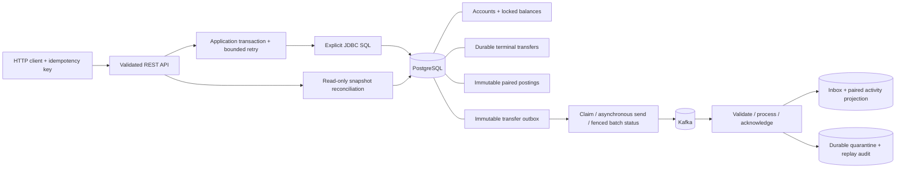

# Operations and detailed engineering reference

This reference preserves the complete pre-showcase README and historical evidence distinctions. Start with the [project overview](../README.md) or [guided demo](demo.md) for a shorter introduction.

A Java/PostgreSQL/Kafka backend for reliable transfers in a fictional unit of value. Its immutable double-entry ledger feeds a transactional outbox, bounded asynchronous Kafka publication, durable consumer inbox, independently queryable account activity and audited quarantine/replay. Phase 3 measures pipeline stages and adds optional backlog admission while preserving those financial boundaries.

This is an independent educational portfolio project, licensed Apache-2.0. It handles no real money or customer data. The completed Phase 1 synchronous core is preserved at commit `2fd2543`; its [40-test evidence](testing.md) and [measured benchmarks](performance.md) remain separate from Phase 2 event-pipeline evidence. The application remains one modular monolith.

## What works

The historical [Phase 2 completion report](phase2-report.md) covers its verified failure behavior, executed tests and measured results. Completed Phase 3 evidence includes [twenty-eight timed trials](phase3-performance.md), [matched methodology](phase3-benchmark-methodology.md), the [portfolio walkthrough](portfolio-walkthrough.md), [clean 94-test verification](verification/phase3-clean-verify.json) and [final-image runtime acceptance](verification/phase3-final-acceptance.json).

Create empty USER accounts, inspect balances, submit synchronous transfers, recover their terminal results, and page through immutable ledger entries. Completed transfers have exactly two postings, equal in magnitude and opposite in sign. The materialized balance equals the account's ledger sum. Deferred PostgreSQL checks enforce both at commit. Reconciliation independently checks the whole dataset.

Durable globally unique idempotency keys replay completed **and rejected** results; a changed payload conflicts. Ordered row locks protect balances and status across multiple application instances. Infrastructure failures roll back; a lost response after commit is recovered by the same key. Exact integer FIC minor units range from 1 to 9,000,000,000,000,000 per transfer; USER balances range 0 to that maximum. Cross-unit requests are rejected.

Completing a transfer atomically creates one immutable `TransferCompleted` outbox event, including controlled issuance fixtures. Kafka is outside that financial transaction, so transfers can commit while the broker is unavailable. One relay coordinator claims a bounded batch, renews live generations together, sends asynchronously outside SQL, and settles per-event outcomes in a fenced batch transaction. Outstanding producer calls stay bounded across deadlines and late callbacks; full successful batches immediately continue. Publication success follows committed status, separately from broker acknowledgement. A crash between acceptance and that status write can publish a duplicate with the same event identity.

The consumer commits its inbox identity, transfer projection and two account activity rows together. Kafka offsets advance only after that effect or a durable PostgreSQL quarantine commit. Bounded, audited replay uses the same inbox processor. The guarantee is **at-least-once transport with idempotent PostgreSQL effects**, with no universal exactly-once delivery claim.

Optional [backlog admission](backpressure.md) is **disabled by default**. When enabled, cached unpublished and published-without-inbox count/age thresholds, sample freshness and reopening hysteresis can refuse a new key with HTTP 503. Admission follows durable key arbitration and precedes account locks/mutations; denial rolls the new reservation back. Existing-key replay/conflict retains its prior behavior. This is a best-effort pressure signal: concurrent requests and separate instances can overshoot its thresholds.

## Architecture



The SQL transaction includes request reservation, optional admission, both account/balance locks, paired postings, balance changes, terminal state and the outbox event. The HTTP result follows database commit. Spring Boot 4.1.1 and Java 21 use explicit JDBC SQL and Flyway against PostgreSQL 17.11. Kafka broker/client 4.3.1 provide asynchronous transport. See [architecture](architecture.md), [event contract](event-contract.md), [outbox](outbox.md), [consumer reliability](consumer-reliability.md), [failure matrix](failure-matrix.md), [ledger invariants](ledger-and-invariants.md), [concurrency](concurrency.md), and [ADRs](adr/).

## Quick start

Prerequisites: Docker with Compose. First build downloads Maven and Java dependencies. The runtime image uses Java 21; no host Java is needed for Compose.

```sh
docker compose up --build -d
docker compose ps
curl http://localhost:8080/actuator/health/readiness
# When readiness is UP, provision the deterministic local-only double-entry fixture:
docker compose exec -T db psql -U tpp -d tpp -v ON_ERROR_STOP=1 < scripts/seed-demo.sql
```

If a prior Phase 1 or Phase 2 deployment is running, preserve it with a separate Compose project and unused ports:

```sh
DB_PORT=55434 APP_PORT=28080 KAFKA_PORT=29092 \
  docker compose --project-name tpp-phase3-local up --build -d --wait --wait-timeout 180
docker compose --project-name tpp-phase3-local exec -T db \
  psql -U tpp -d tpp -v ON_ERROR_STOP=1 < scripts/seed-demo.sql
docker compose --project-name tpp-phase3-local exec -T db \
  psql -U tpp -d tpp -v ON_ERROR_STOP=1 < scripts/verify-runtime-role.sql
python3 scripts/event-smoke.py --base-url http://127.0.0.1:28080
```

Use matching project names and URLs in subsequent commands. Containers bind to loopback. `DB_PASSWORD` and `MIGRATION_PASSWORD` override the local-only defaults; initial database role/password setup applies only on a fresh volume. Existing credentials must be changed deliberately.

Compose includes a persistent single KRaft Kafka broker with replication factor one and `min.insync.replicas=1`; it demonstrates recovery, not redundant broker durability. Application readiness depends on PostgreSQL and startup does not require Kafka readiness. Compose `--wait` checks the complete development stack. Both workers default off for a host application and on in Compose; `EVENTS_RELAY_ENABLED` and `EVENTS_CONSUMER_ENABLED` control them when starting/recreating the app.

Backlog admission defaults off in both environments. Set `BACKPRESSURE_ENABLED=true` when starting/recreating the app to enable it, and inspect `/internal/backpressure` for cached count, age, freshness and the admission reason. The [configuration table](backpressure.md#configuration) lists all settings and default thresholds; defaults are examples, not measured safe capacity limits.

The owner runs migrations and fixtures; `tpp_app` handles normal requests with restricted privileges. The fixture credits Alice and Bob 1,000,000 minor units each from the special issuance account. Its matching negative issuance balance keeps total value zero. Rerunning it does not fund twice. There is no public mint endpoint.

Stop the selected project with `docker compose --project-name tpp-phase3-local down`; this retains PostgreSQL and Kafka volumes. Remove **only this project's disposable local volumes** with `down -v` when intentionally discarding its history.

## API examples

OpenAPI 3.1 is served at [localhost/openapi.yaml](http://localhost:8080/openapi.yaml) and checked into [the repository](../src/main/resources/static/openapi.yaml).

```sh
# New accounts start at zero; this endpoint never accepts a starting balance.
curl -i -X POST http://localhost:8080/api/accounts \
  -H 'Content-Type: application/json' -d '{"unit":"FIC"}'

# Use the deterministic, explicitly funded demo accounts.
curl -i -X POST http://localhost:8080/api/transfers \
  -H 'Content-Type: application/json' \
  -H 'Idempotency-Key: demo-transfer-001' \
  -H 'X-Correlation-ID: example-request-001' \
  -d '{"sourceAccountId":"00000000-0000-0000-0000-000000000002","destinationAccountId":"00000000-0000-0000-0000-000000000003","amount":100,"unit":"FIC"}'

curl http://localhost:8080/api/accounts/00000000-0000-0000-0000-000000000002/balance
curl 'http://localhost:8080/api/accounts/00000000-0000-0000-0000-000000000002/ledger?limit=20&after=0'
curl http://localhost:8080/internal/reconciliation
curl 'http://localhost:8080/api/accounts/00000000-0000-0000-0000-000000000002/activity?after=0&limit=50'
curl http://localhost:8080/internal/events/status
curl http://localhost:8080/internal/events/reconciliation
curl http://localhost:8080/internal/backpressure
curl 'http://localhost:8080/internal/quarantine?after=0&limit=50'
```

A new completed transfer returns 201 and a Location. Repeat the identical transfer request/key to receive 200 with the original ID, timestamps and result, plus `Idempotency-Replayed: true`. Change amount/source/destination/unit under that key to receive 409 (unsupported units are rejected before reservation). An admitted valid request with insufficient funds, missing/inactive/issuance accounts or destination overflow becomes durable REJECTED and returns 422. GET its Location to retrieve its status. Retrying that rejected key keeps the original rejection, even after funding changes.

```json
{"code":"IDEMPOTENCY_CONFLICT","message":"Idempotency-Key was already used with a different payload","correlationId":"example-request-001"}
```

400 covers invalid syntax/amounts/units/headers; 404 covers unknown GET resources; 503 covers dependency/timeouts and enabled admission denial. `EVENT_BACKLOG_OVERLOADED` means pressure or reopening hysteresis refused the new reservation; `BACKLOG_STATUS_UNAVAILABLE` means no usable fresh sample exists. Both admission responses include `Retry-After: 1` and the correlation ID, persist no financial result/key, and permit retry with the same key/payload. Existing-key recovery and conflict bypass admission. Unexpected 500 and client/connection timeouts may be ambiguous: **reuse the same key and payload** to discover the durable outcome. Idempotency keys accept 1–128 ASCII letters, digits, dots, underscores, colons and hyphens. They are global and retained without expiry.

Activity is eventually consistent and never determines spendable balances. `GET /internal/outbox/{eventId}` inspects stable identity, claim/publication metadata, errors and projection/quarantine state. Event reconciliation separates ordinary lag from structural discrepancies. Inspect a quarantine record and its audits with `GET /internal/quarantine/{id}` and `GET /internal/quarantine/{id}/replays`. Replay uses `POST /internal/quarantine/{id}/replays` with a nonblank `reason` and optional `correctedPayload` JSON text. Requeue a BLOCKED outbox after correcting its operational cause with `POST /internal/outbox/{eventId}/requeues` and a reason. These are trusted local operator interfaces.

### Transfer delivery progress

`GET /internal/transfers/{id}/delivery` looks up one terminal transfer from PostgreSQL. It does not connect to Kafka. Successful responses use `Cache-Control: no-store` and include the terminal financial decision, the observed delivery state and the event ID if available.

| Delivery state | What the snapshot establishes |
|---|---|
| `NOT_APPLICABLE` | The transfer was rejected and has no event. |
| `AWAITING_PUBLICATION` | Finance committed. The event is pending or claimed and no projection has committed. A failed or interrupted send can have an uncertain broker outcome. |
| `AWAITING_PROJECTION` | The relay recorded publication, but the consumer's projection has not committed. |
| `BLOCKED` | The event is blocked and has no committed projection. Inspect the stored error code and event ID before taking action. |
| `PROJECTED` | The matching inbox and activity projection committed. The relay's recorded publication status can still be pending, claimed or blocked. |
| `INCONSISTENT` | Required durable records are missing or disagree. Investigate using reconciliation. |

`event.publicationStatus` describes what the relay recorded. Consumers can observe Kafka before the relay commits that record, so `PROJECTED` does not require the publication status to be `PUBLISHED`. It also does not prove the Kafka group offset was acknowledged. `nextAttemptAt` is present only for pending events and is a scheduling boundary, not a promise that the next attempt starts then. Timestamps come from the stored database records. No account identifiers, transfer amount, payload, idempotency key, claim token or detailed error text are included. Use the endpoint only in the existing trusted local environment.

The optional Transfer Lab follow loop performs bounded, sequential reads of this point endpoint for the selected ID. It keeps waiting when projection is present but the recorded publication has not settled, and labels the last successful response if a subsequent read fails. It does not poll the immutable postings on each tick. An exported observation records the two browser read times separately and is not evidence of a shared database snapshot.

For financial evidence, `GET /internal/transfers/{id}/ledger-proof` reads the transfer intent and matching immutable postings in a single PostgreSQL snapshot. `BALANCED_PAIR` confirms the exact signed source debit and destination credit for that ID. `NO_POSTINGS` indicates a rejected transfer without ledger postings. `INCONSISTENT` means the rows do not match the expected effects. It returns up to three observed rows, which is enough to detect extras without scanning an account's journal. Entry IDs are strings so a browser preserves their precision. This trusted-local endpoint includes account IDs and the transfer amount, unlike the delivery endpoint. Neither response establishes the current balances or the absence of effects under a different transfer ID.

`GET /internal/demo/transfers` only exposes terminal decisions between the seeded Alice and Bob accounts in either direction. It returns no receipts, idempotency keys, other accounts or funding records. Request up to 20 decisions per page (default six) and use the supplied `nextBefore` token to read the next page. Each page reads one PostgreSQL snapshot using two bounded directional queries backed by a partial index. Pages are ordered by stored decision timestamp and transfer ID, not by the order in which a browser saw responses. New decisions may appear between page reads. Refresh the first page to see them.

## Build and test

Host development requires a Java 21 JDK and a working Docker daemon. Point `JAVA_HOME` at Java 21 if another version is the default. Maven Wrapper pins and verifies Maven 3.9.16.

```sh
./mvnw -B -ntp clean verify
# Optional host service, against the Compose DB (adjust port/passwords if changed):
DB_USERNAME=tpp_app DB_PASSWORD=local-app-password \
MIGRATION_USERNAME=tpp MIGRATION_PASSWORD=local-owner-password \
./mvnw spring-boot:run
```

Tests use real PostgreSQL/Kafka Testcontainers with no H2 fallback and no automatic skip when Docker is unavailable. An explicitly supplied real PostgreSQL admin URL can run the core/admission PostgreSQL subset; that harness creates and drops its own random database and requires CREATEDB. Full pipeline verification requires Docker. See [testing instructions and executed evidence](testing.md).

The preserved Phase 1 clean checkout passed 40 tests (12 unit, 28 real PostgreSQL integration), with 0 failures/errors/skips. Tests include two live application instances, competing requests, fixed-seed generated sequences, real lock/statement timeouts, pool exhaustion, all core fault boundaries, restart, corruption detection and an actual client timeout after commit.

A fresh local clone of implementation commit `503ed39` completed `clean verify` in 114 seconds. The complete Phase 1 + Phase 2 verification passed **64 tests: 16 unit and 48 real dependency integration**, with zero failures, errors or skips on 11 October 2026 at 22:03:57 Singapore time. Integration includes 28 core PostgreSQL regressions, 19 PostgreSQL/Kafka scenarios and one populated V1 migration upgrade. F1–F10, replay identity/budget, real consumer contention/rebalance, competing publishers, immutable/atomic event effects and both startup-classification regressions passed. SpotBugs at Max effort/Medium threshold reported zero bugs/errors; dependency convergence and release-only dependency checks passed. [Saved execution evidence](verification/phase2-clean-verify.json) and the [failure matrix](failure-matrix.md) distinguish these results from configuration. Target the event suite during development with `./mvnw -B -ntp -Dtest=EventContractTest,EventPipelineTest test`.

The restricted-role Compose deployment also passed real HTTP submission, same-key replay, Kafka-derived paired activity and both reconciliations. Its [saved smoke result](benchmarks/phase2-smoke.json) contains observed event/transfer identities and timestamps. The final image also [started with Kafka service DNS absent](verification/phase2-dns-startup-recovery.json), committed a transfer, and published/projected it after the broker returned without restarting the app.

Phase 3's final fresh clean clone at `2c859cb28d3b1898a2a7d25c5c87d7a0a0a3dbe4` passed **94 tests: 34 unit and 60 real dependency integration**, with zero failures/errors/skips. `clean verify` completed in 3 minutes 31 seconds at **00:11:26 Singapore time on 12 October 2026**. SpotBugs Max/Medium reported zero bugs/errors, and Java/Maven requirements, dependency convergence and release-only checks passed. [Saved per-class and all-method execution evidence](verification/phase3-clean-verify.json) includes the actual outstanding-send observations. New coverage includes bounds across deadlines, stale batch fencing, real deferred-COMMIT rollback, shutdown and admission rollback/recovery. The [earlier 92-test phase/static failure](verification/phase3-initial-verify.json), [focused checks](verification/phase3-commit-focused.json) and [separate static pass](verification/phase3-static-verify.json) remain historical evidence.

Final review also found a relay start/stop scheduling race. The [lifecycle regression](verification/phase3-lifecycle-red-green.json) failed its intended assertion against measured source `66dc7c9`; the minimal correction at `1737a27` then passed two focused cases. Reflection models admitted-start field writes, followed by real same-instance HTTP/Kafka publication, offset progress and reconciliation. Corrected source also passed [separate static/dependency checks](verification/phase3-lifecycle-static.json). All measured trials retained the original fixed images; this later lifecycle correction was not rebenchmarked.

Two earlier fresh 94-test attempts each retained one failed setup assertion: [the first](verification/phase3-clean-first-failure.json) assumed six sends stayed outstanding after broker stop; [the second](verification/phase3-clean-second-failure.json) did not establish one outstanding send for shutdown. The corrected [partial-bound case](verification/phase3-partial-bound-correction.json) pauses the real broker, explicitly observes two accepted ACKs and zero in-flight sends before pause, then verifies six outstanding sends and no more than two next claims. The corrected [shutdown case](verification/phase3-shutdown-correction.json) observes three sends/enqueues, two accepted ACKs, zero failed ACKs and one actual outstanding send; final clean execution stopped in 7.004 seconds, then four claims recovered and reconciled. Its earlier 10-second timeout-setting mismatch remains in the evidence. Final source `2c859cb` retains the lifecycle-corrected production code from `1737a27` with these test-fixture corrections; final-image runtime acceptance is separate from the successful build.

The final image was [built from that literal clean verified checkout](verification/phase3-final-build.json) and passed [runtime acceptance](verification/phase3-final-acceptance.json) on Phase 3 port 28080. Readiness was UP, the [restricted `tpp_app` role probe](verification/phase3-final-runtime-role.txt) passed, and an [actual transfer plus same-key replay](verification/phase3-final-http-event-smoke.json) retained one stable outbox/inbox/projection identity and paired -7/+7 ledger/activity. All 188,884 completed events were published, processed and projected with zero discrepancies, backlog or quarantine; all three independently inspected committed offsets matched broker log end. Admission remained disabled with no sample. [Runtime provenance](verification/phase3-final-runtime-provenance.json) records the final image, unchanged Phase 1/2 containers and retained Phase 3 database/broker containers and volumes. This acceptance uses final source `2c859cb`; the earlier measured optimized image at `66dc7c9` was not rebenchmarked after the lifecycle correction.

GitHub Actions is configured to run a clean dependency-backed build, construct the image, execute Compose HTTP/event smoke checks, and retain reports. Configured CI is separate from executed CI evidence; the repository has not been pushed.

## Benchmark and operations

```sh
python3 scripts/benchmark.py --prepare --compose-db \
  --workers 8 --duration 15 --warmup 3 \
  --output benchmark-results/local.json \
  --environment-notes 'Describe your CPU, RAM and Docker allocation'
```

The benchmark explicitly funds a new isolated dataset through privileged SQL; it never mints over HTTP, deletes history or resets existing accounts. It compares independent pairs with a shared source. It records throughput, latency percentiles, offered/completed responses, error distribution, transaction durations, retry counts, sampled pool utilization and PostgreSQL lock waits. It checks reconciliation before and after. See [methodology](benchmark-methodology.md), [measured results](performance.md), and [raw reports](benchmarks/).

The retained benchmark can exercise the current core API; reproducing the original Phase 1 image/configuration requires snapshot `2fd2543` in a separate checkout and database deployment.

Those retained measurements describe the Phase 1 image. Phase 2 measurements must use their own evidence: `scripts/event-benchmark.py` records offered/started/completed/failed HTTP operations, durable event publication/processing progress, propagation latency, lock samples and backlog catchup, with sampled invariants and reconciliation. See the [Phase 2 methodology](phase2-benchmark-methodology.md) for matched worker-enabled/disabled trials, actual broker outage recovery, limited relay capacity and a slowed active consumer. The [measured Phase 2 results](phase2-performance.md) include four matched trials, broker recovery, a slowed active consumer and shared-source contention. Relay-enabled low-contention HTTP completion was 1,126–1,241/s; publication catchup was about 106–124/s. Backlogs drained with clean reconciliation. The contention trial retained three HTTP 503 responses, and trial variation prevents a precise causal overhead estimate. Do not relabel the old synchronous throughput as event-pipeline throughput.

Phase 3 uses immutable baseline/optimized images, the same finite harness, and declared ABBA trial order; admission stays disabled in both comparison conditions. The [original stage diagnostic](benchmarks/phase3-baseline-stage-analysis.json) found 75.4% polling-pause time and 4.204 seconds of per-event renewal/status SQL work. The [optimized diagnostic](benchmarks/phase3-profile/optimized-stage-analysis.json) scheduled 4,000 requests at 500/s for eight seconds: 3,934 completed and 66 were locally shed, with no HTTP or ambiguous client errors. Its first post-input SQL snapshot had zero unpublished events and 949 published events awaiting processing. The fresh remaining consumer drain processed 813 events in 1.331 seconds, about 610.7/s. These diagnostics remain separate from the matched trials. Consumer processing remains sequential; concurrent-input transaction/offset timings point to shared database/HTTP resource contention as the next investigation. See [methodology](phase3-benchmark-methodology.md), [current performance report](phase3-performance.md), and the [walkthrough](portfolio-walkthrough.md) for evidence and limits.

The [twenty primary trials](benchmarks/phase3-comparison-summary.json) completed across five ABBA suites. Low-contention HTTP completion was 1,220–1,242/s for baseline versus 1,079–1,084/s for optimized, while remaining event drain fell from 95.31–110.14 seconds to 12.86–13.02 seconds and final propagation p99 from 94.08–109.37 seconds to 13.99–14.45 seconds. At 500 scheduled arrivals/s for thirty seconds, optimized publication kept up, but 2,410–2,872 events still awaited processing after input and 534–649 of 15,000 arrivals were locally shed. This is not demonstrated stable end-to-end capacity at 500/s.

All twenty primary trials ultimately reconciled, retained one projection effect with paired activity per scoped completed transfer, and ended at zero committed-offset lag in all three partitions. The original shared-source series retained six optimized plus three baseline dependency HTTP 503s and declined strongly with chronology. Its [fixture audit](benchmarks/phase3-high-fixture-order-audit.json) found changing account lock order, so it does not isolate a causal HTTP gain. Broker-outage trials recovered every completion; the fifteen retried events in each optimized trial count durable publication attempts, not observed Kafka duplicates. Restoring a slowed consumer recreated the whole app; both optimized datasets had fully processed before the fresh recovery snapshot, leaving no observed recovery throughput.

The separate [250/s ABBA](benchmarks/phase3-sustainable-250-summary.json) observed no optimized publication or processing backlog at the input-end snapshots, propagation p99 of 304–314 ms and 7,427–7,433 completions from 7,500 scheduled arrivals. Baseline needed 41.1–42.6 seconds of remaining drain. This is one thirty-second operating point. A global inspection failed after optimized trial three when PostgreSQL could not allocate shared memory under the unchanged 64 MiB limit; independent reconfirmation found all 178,795 global events complete, and baseline trial four continued once with the interruption retained. The [controlled shared-source ABBA](benchmarks/phase3-high-controlled-summary.json), using a separately gated fixture harness, fixed all eight destinations below the source. B/O/O/B completion rates were 42.4/47.7/44.6/40.6 per second with 7/3/2/10 dependency 503s and roughly 712 ms HTTP p99 throughout. Final effect/offset checks passed; those failures and limited repeats prevent a general shared-source HTTP improvement claim.

Structured JSON logs include event, transfer and correlation IDs and bounded outcome classifications. Actuator provides `/actuator/health/liveness`, DB-backed `/actuator/health/readiness`, and `/actuator/metrics`. Stage timers distinguish claim/renew/settle, Kafka enqueue/ACK/wait, consumer transaction/work/completion, offset acknowledgement and explicit pauses. Event signals distinguish publication backlog, retries, expired claims, consumer outcomes, duplicates, quarantines, offset failures and projection discrepancies. Admission counters classify allowed/blocked decisions with bounded reasons. Snapshot-age gauges expose stale database metrics; Kafka supplies local maximum record lag when available, while benchmark broker snapshots separately inspect committed-offset lag. These are unauthenticated local inspection interfaces.

## Limits and next phase

This is not production-ready financial infrastructure. There is no authentication/authorization, tenant namespace, real payment integration, FX, multi-broker failure validation, DB failover validation, network-partition experiment, automated backup/restore or cloud deployment. A privileged DB owner can bypass protections. Ledger, outbox, inbox, projection, quarantine and audit history have no retention policy. Kafka retention can expire unread records; automatic projection rebuild after retention loss is not implemented. Reconciliation and deferred checks scan history. Local closed-loop benchmarks do not prove open-loop capacity or production reliability.

Transport duplicates are expected. An expired lease owner can still send to Kafka, although it cannot overwrite a newer claim's database state. The inbox protects the defined PostgreSQL activity effect; external effects need their own durable boundary. Next priorities are a tested archive/retention/rebuild design, multi-broker and database recovery experiments, and measured relay/projection scaling that preserves the existing invariants.
